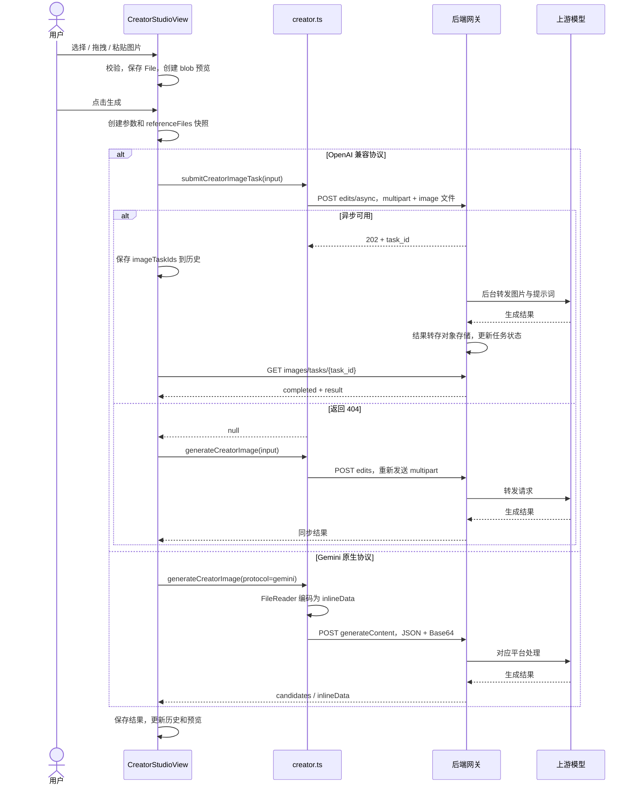

# 创作中心图片模块开发文档：参考图上传与生成链路

核对日期：2026-11-09。本文依据当前工作区源码，包含尚未提交的页面改动；描述代码实现，不代表已核验线上节点配置。

适用范围：创作中心的图片创作、参考图添加、预览、生成请求、历史恢复及作品复用。视频参考图仅用于说明实现边界。

## 1. 核心机制

当前参考图采用“本地选图和预览 → 点击生成 → 图片随生成请求一起提交”的方式。

用户添加参考图时，页面保存浏览器的 `File` 对象，通过 `URL.createObjectURL(file)` 创建本地预览地址。这个步骤不调用独立上传接口，也不先把参考图上传到对象存储换取 URL。

点击生成后，根据当前分组的平台选择请求协议：

- OpenAI 兼容协议：把 `File` 放进 `FormData`，以重复的 `image` 字段提交到图片编辑接口。页面优先尝试异步接口 `/v1/images/edits/async`，不可用时退回 `/v1/images/edits`。
- Gemini 原生协议：用 `FileReader` 把文件编码为 Base64，放入 `contents[].parts[].inlineData`，调用 `/v1beta/models/{model}:generateContent`。

因此，参考图的 `blob:` 预览地址只供当前浏览器显示；实际提交的是文件内容。异步图片的对象存储主要承接生成结果，不是这条参考图输入链路的前置上传服务。

## 2. 代码入口

### 2.1 前端

- `frontend/src/views/user/CreatorStudioView.vue`：参考图控件、文件校验、GIF 转换、预览和移除、生成参数快照、异步任务恢复、作品转参考图。
- `frontend/src/api/creator.ts`：`ImageGenerationInput`、OpenAI multipart 组包、Gemini Base64 组包、异步任务提交和查询、结果归一化及图片下载。
- `frontend/src/api/url.ts`：`buildGatewayUrl()`，生成网关请求地址。
- `frontend/src/services/creatorHistory.ts`：作品历史和任务 ID 的 IndexedDB 持久化。
- `frontend/src/services/creatorImageBlobs.ts`：生成结果的 Blob 转换与缓存。

该页面直接实现参考图交互，并未使用通用的 `frontend/src/components/common/ImageUpload.vue`。修改创作中心上传逻辑时，应先定位 `CreatorStudioView.vue` 中的 `addReferenceFiles()`。

### 2.2 后端

- `backend/internal/server/routes/gateway.go`：图片生成、编辑、异步提交、任务查询及下载路由。
- `backend/internal/handler/openai_images.go`：OpenAI 图片同步入口、鉴权上下文、权限、审核、并发和计费检查。
- `backend/internal/handler/image_task_handler.go`：异步提交、后台执行与任务查询。
- `backend/internal/service/openai_images.go`：解析 multipart、记录输入文件、选择转发方式。
- `backend/internal/service/openai_images_direct.go`、`openai_images_responses.go`：OAuth/Codex 等上游图片协议转换。
- `backend/internal/handler/grok_media.go`、`backend/internal/service/grok_media.go`：Grok 图片入口和输入转换。
- `backend/internal/service/image_task.go`、`backend/internal/repository/image_task_store.go`：任务状态与 Redis 存储。
- `backend/internal/service/image_storage.go`：生成结果转存对象存储。

## 3. 前端参考图数据模型

```ts
interface ReferenceImage {
  file: File
  url: string
}

const referenceImages = ref<ReferenceImage[]>([])
```

两个字段各有用途：

- `file`：实际上传内容，包含文件字节、名称、MIME 类型和大小。
- `url`：`URL.createObjectURL(file)` 返回的本地临时地址，用于 `` 预览。

页面通过 `activeReferenceImages` 读写当前参考图列表。在图片模式下，它对应 `referenceImages`；在专业视频模式下，它会对应当前镜头的列表。

`url` 不能作为远端模型可访问的图片链接，也不能代替 `file` 写入生成请求。

## 4. 文件如何进入列表

### 4.1 三个入口共用一个处理函数

页面提供三种添加方式，最终都调用 `addReferenceFiles(files)`：

1. 文件选择：隐藏的 `<input type="file">` 触发 `handleFileInput()`。
2. 拖拽：上传区域的 `drop` 事件触发 `handleDrop()`，读取 `dataTransfer.files`。
3. 粘贴：页面激活时监听 `window` 的 `paste` 事件，`handlePaste()` 从 `clipboardData.files` 取出图片文件。

文件输入框的 `accept` 为：

```text
image/png,image/jpeg,image/webp,image/gif
```

`accept` 只是浏览器文件选择提示；实际格式和大小检查在 `addReferenceFiles()` 内完成。粘贴入口只处理剪贴板中的图片文件，不会把粘贴的普通图片网址自动下载为参考图。

文件选择完成后执行 `input.value = ''`，使用户移除图片后再次选择同一文件仍能触发 `change`。

### 4.2 校验与处理顺序

图片模式下的处理顺序为：

1. 按当前能力计算剩余参考图名额。
2. 遍历候选文件；GIF 先转换为首帧 PNG。
3. 只接受 MIME 为 `image/png`、`image/jpeg`、`image/webp` 的处理后文件。
4. 检查单张大小。
5. 按剩余名额截取有效文件。
6. 为每个接受的文件创建 Object URL，追加到参考图列表。

不合格文件会提示具体原因并跳过，同批其他合格文件仍可加入。有效文件超出剩余数量时，只保留可容纳的部分并提示。

### 4.3 当前限制

- `image2` 能力：页面最多接受 16 张参考图。
- 其他图片能力（`grok`、`banner`）：页面最多接受 3 张。
- 单张大小：`10 * 1024 * 1024` 字节，即 10 MiB；界面文案写作 10MB。
- 图片模式没有实现前端总字节数上限，也没有统一的图片长边缩放或 JPEG 压缩步骤。

这些数量是当前页面策略，不代表每个上游模型都保证支持同样数量。后端、反向代理和目标模型仍有各自约束。

当前前端依赖文件的 MIME 类型和大小作筛选，没有在此图片分支中统一进行文件头识别、分辨率上下限校验或重复内容去重。开发新入口时，应明确这些检查由哪一层负责。

GIF 的大小检查发生在首帧转换之后，因此约束的是转换后的 PNG 大小。PNG/JPEG/WebP 在该分支中保留文件内容，不会因为预览或选择 1K 输出而自动缩小输入参考图。

### 4.4 GIF 首帧转换

`gifFirstFrameAsPng()` 的流程：

```text
GIF File
  → createImageBitmap(file)
  → 创建与 bitmap 同宽高的 Canvas
  → drawImage(bitmap, 0, 0)
  → canvas.toBlob(..., 'image/png')
  → new File([blob], '原文件名.png', { type: 'image/png' })
```

函数在 `finally` 中调用 `bitmap.close()`。上传的参考图只保留首帧，不会把 GIF 动画作为多帧参考输入；这与生成结果支持 GIF 输出是两件事。

### 4.5 预览与资源释放

模板直接使用 `reference.url`：

```vue

```

`removeReference()` 删除列表项时释放对应 URL；`clearReferenceImages()` 清空时释放所有参考图 URL；组件卸载时也会统一释放。路由缓存导致的组件停用会移除粘贴监听，卸载与暂时停用的处理并不相同。

新增清空、替换或批量移除功能时，需要保持 `URL.revokeObjectURL()` 的释放逻辑。

## 5. 点击生成后的完整链路



`generateFromCurrentSettings()` 会创建 `ImageGenerationSnapshot`，用 `referenceImages.value.map(reference => reference.file)` 捕获提交时的参考文件。

随后 `generateImageWork()` 使用这个快照构造 `ImageGenerationInput`，避免任务参数直接依赖后续编辑的草稿状态。

当前分组平台为 `gemini` 或 `antigravity` 时走 Gemini 协议，其余走 OpenAI 兼容协议。协议选择依据分组平台，不只是界面上显示的图片能力名称。

Image2 与 Gemini 的多张输出按每次一张拆成多个请求；每个请求都携带同一批参考文件。参考图不会先上传一次后通过共享文件 ID 在多个请求中复用。

## 6. OpenAI 兼容请求实现

### 6.1 是否有参考图决定接口

- 无参考图：JSON 请求 `/v1/images/generations/async`，不可用时调用 `/v1/images/generations`。
- 有参考图：multipart 请求 `/v1/images/edits/async`，不可用时调用 `/v1/images/edits`。

关键代码位于 `submitCreatorImageTask()` 和 `generateOpenAIImage()`：

```ts
const form = new FormData()

for (const [name, value] of Object.entries(buildOpenAIJSONPayload(input))) {
  appendFormValue(form, name, value)
}

for (const reference of references) {
  form.append('image', reference, reference.name)
}
```

多图使用重复的 `image` 字段。当前前端不使用 `reference_images`、`image[]` 或 `files` 字段来提交这条图片编辑请求。

请求头包含：

```text
Authorization: Bearer <当前分组的 API Key>
X-Sub2API-Creator: image
```

multipart 请求不手动设置 `Content-Type`，由浏览器连同 boundary 一起生成。这里使用原生 `fetch`，不经过默认携带 JSON Content-Type 的 Axios 管理接口客户端。

`buildGatewayUrl()` 使用 API 配置对应的 origin 拼接 `/v1/...`，不是直接拼接管理接口的 `/api/v1` 前缀。

### 6.2 文本参数

提示词和生成参数也写入同一个表单，例如 `model`、`prompt`、`n`、`size`、`quality`、`background`、`output_format`。实际字段取决于模型及参数组包逻辑；例如 GPT Image 模型不发送旧的 `response_format`。

参考图是输入内容，`size` 是输出尺寸，两者独立。选择明确的 Image2 1K 方形尺寸时可提交 `1024x1024`；当前 Image2 默认输出尺寸模式为 `auto`，不能把所有请求都描述为固定 1024 像素。

### 6.3 调用示例

以下为开发者联调示例，域名、Key 和本地路径均需替换。重复 `-F image=@...` 表示多参考图：

```bash
curl 'https://<网关域名>/v1/images/edits/async' \
  -H 'Authorization: Bearer <API_KEY>' \
  -H 'X-Sub2API-Creator: image' \
  -F 'model=gpt-image-2' \
  -F 'prompt=保留主体外观，将背景改为暖色摄影棚' \
  -F 'n=1' \
  -F 'size=1024x1024' \
  -F 'quality=high' \
  -F 'output_format=png' \
  -F 'image=@/本地路径/subject.png' \
  -F 'image=@/本地路径/style.webp'
```

异步不可用并返回 404 时，可改用相同表单调用同步 `/v1/images/edits`。前端只把异步提交的 404 视为降级条件，其他 HTTP 错误会直接报错。

首次异步探测请求本身携带图片；降级时同步请求会再次发送文件。页面在内存中按 API Key 缓存异步不可用状态，后续请求可跳过探测。

## 7. Gemini 请求实现

`generateGeminiImage()` 先调用 `toGeminiInlineData()`，通过 `FileReader.readAsDataURL()` 读取文件，再去掉 `data:image/...;base64,` 头，只保留 Base64 数据。

请求结构示意如下，`<文件的 Base64>` 是占位内容：

```json
{
  "contents": [
    {
      "role": "user",
      "parts": [
        { "text": "保留主体外观，将背景改为暖色摄影棚" },
        {
          "inlineData": {
            "mimeType": "image/png",
            "data": "<文件的 Base64>"
          }
        }
      ]
    }
  ],
  "generationConfig": {
    "responseModalities": ["TEXT", "IMAGE"],
    "imageConfig": {
      "aspectRatio": "1:1",
      "imageSize": "1K"
    }
  }
}
```

接口为 `/v1beta/models/{model}:generateContent`，使用 Bearer API Key 和 `Content-Type: application/json`。多张参考图按列表顺序转换为多个 `inlineData` part。

这条前端路径不使用图片异步任务接口；`submitCreatorImageTask()` 遇到 Gemini 协议会直接返回 `null`。Base64 通常比原始二进制增加约三分之一的传输体积，排查大请求时应按编码后的 JSON 体积考虑。

## 8. 后端如何接收和转发参考图

### 8.1 OpenAI multipart 解析

`ParseOpenAIImagesRequest()` 根据 Content-Type 选择 JSON 或 multipart 解析。multipart 解析器从 boundary 中逐个读取 part，提取文件名、MIME 和字节内容，保存为 `OpenAIImagesUpload`：

```go
type OpenAIImagesUpload struct {
    // 省略其他字段
    FieldName   string
    FileName    string
    ContentType string
    Data        []byte
}
```

后端接受名称为 `image` 或以 `image[` 开头的文件字段；因此兼容其他客户端使用 `image[]`，但当前创作中心发送的是重复 `image`。

解析器对单个 part 设置 50 MiB 上限，使用“多读一个字节后判超限”的方式拒绝过大 part，避免静默截断后向上游转发损坏图片。此处的后端上限与前端单张 10 MiB 不是同一层限制。

网关整包限制由 `gateway.max_body_size` 决定，源码默认 256 MiB；线上实际还取决于部署配置和反向代理限制。Grok 使用独立解析器，不能把 OpenAI 解析器的 50 MiB 限制当作所有平台的统一规则。

### 8.2 上游协议转换

网关收到 multipart 后，根据账号和平台选择实际转发方式：

- OpenAI API Key 账号：走 `forwardOpenAIImagesAPIKey()`，以图片接口转发请求；模型映射需要修改表单时会重建 multipart。
- OAuth / SetupToken 账号：走 `forwardOpenAIImagesOAuth()`，根据当前路由使用直接图片接口或 Responses 图片工具链路；上传文件可被转换为 Data URL，再放进上游所需的 `images` 或 `input_image` 结构。
- Grok 分组：走 `GrokImages()`，把 multipart 图片转换为其上游接受的图片引用结构。

所以“浏览器向网关发送文件”不意味着“网关向所有上游原样发送 multipart”。前端输入协议与上游实际协议之间存在适配层。

后端同时执行现有鉴权、图片生成权限、模型路由、审核、并发和计费链路。参考图可能进入配置的内容审核流程，不能将其描述为仅停留在本地或绝不发送给审核服务。

## 9. 异步任务、存储和刷新恢复

### 9.1 请求被接受之后

异步处理器校验请求后，创建任务并返回 `202 Accepted`，包含 `task_id` 和 `processing` 状态；后台通过 goroutine 调用现有图片网关。

`newAsyncImageContext()` 用 `context.WithoutCancel()` 脱离原浏览器请求取消，再设置执行超时。默认执行上限为 30 分钟，任务记录默认 TTL 为 24 小时。

任务 ID 和状态保存在 Redis；原始 multipart 请求体保留在运行中的服务进程上下文中，没有作为可重放输入写入任务记录。因此它支持已受理任务在页面刷新后继续执行，但不是能在服务进程重启后自动恢复原始输入的持久任务队列。

### 9.2 生成结果如何保存

当前生产启用方式要求可用的对象存储配置。生成完成后，结果图片先转存到对象存储，再将精简结果和状态写入 Redis，避免把大段 Base64 结果长期放在 Redis。

当前异步提交处理器仅接受 OpenAI 或 Grok 平台分组；其他平台会返回 404。对象存储未启用或配置不完整也会返回 404，所以该状态不一定表示路由不存在。

浏览器记录 `work.imageTaskIds`，调用 `getCreatorImageTask()` 查询状态，并在结果可用时下载、整理和持久化作品。查询任务需要提交任务时的同一个 API Key；相同用户换另一个 Key 也不能读取该任务。

完整的对象存储配置说明见 [ASYNC_IMAGE_TASKS.md](./ASYNC_IMAGE_TASKS.md)。

### 9.3 输入参考图与输出作品分开保存

图片作品历史保存 `referenceCount` 等参数和生成结果，不保存此次上传的输入参考图文件。

浏览器历史使用 IndexedDB，数据库名为 `sub2api-creator-history`，对象仓库为 `works`。生成结果可以保存为 `imageBlobs`；`imageBlobs` 是输出作品内容，不能当作输入参考图备份。

刷新后的行为：

- 已取得任务 ID 的图片任务：可依据历史中的 ID 继续同步结果。
- 多张输出中尚未提交的请求：如果作品使用过参考图，页面不会在原文件丢失后自动补发剩余请求。
- “带回参数”：恢复提示词、分组、模型和输出设置，不会恢复原始上传参考图。
- 历史中的参考图数量只是记录；页面会提示“原始上传文件未保存在历史中”。

视频多镜头队列另有 `referenceBlobs`，不要据此推断图片模式也持久化了输入文件。

## 10. 将生成作品再次作为参考图

结果操作调用 `useOutputAsReference(output, work, index)`：

1. 如果结果是 Data URL，用 `imageDataUrlToBlob()` 解码。
2. 如果是跨域 HTTP 图片，使用 `loadCreatorImageBlob()` 获取；下载辅助逻辑支持直取和网关回退。
3. 其他可读取地址通过 `fetchImageBlob()` 获取 Blob。
4. 检查非空及大小，包装为新的 `File`。
5. 恢复作品当时的生成参数。
6. 调用相同的 `addReferenceFiles()`，创建新的参考图预览。

这是“把输出文件重新变成输入文件”，不是从历史记录恢复最初上传的参考图。

跨域图片的网关回退使用 `/v1/images/download`。Data URL 转 Blob 的代码直接解码本地内容，无需先把 Data URL 当成远端地址请求。

## 11. 格式兼容与扩展边界

### 11.1 SVG 输出

当前 SVG 输出只支持文生图：

- 页面在参考图数量增加且当前输出格式为 SVG 时，自动切换为 PNG，并提供提示。
- API 层用 `assertSvgWithoutReferences()` 再检查一次，避免其他调用方绕过页面校验。
- SVG 生成约束为单张输出；这一约束不表示 SVG 文件能被上传为参考图。

### 11.2 视频压缩规则不适用于图片模式

`optimizeVideoReferenceImage()` 位于视频处理分支。界面中“自动缩至长边 ≤ 2048px / 3MB / 合计 ≤ 15MB”的规则描述视频参考图流程。

图片模式在完成格式、大小和数量检查后直接保存文件，不调用这套视频压缩。扩展图片处理时需显式设计输入尺寸策略，不能因为页面共用上传区域就把视频压缩逻辑当作现有图片行为。

### 11.3 如果后续需要素材库

当前链路没有独立的参考图资产 ID、持久上传 URL、分片续传、服务端素材列表，也没有逐文件网络上传进度。

如果目标改为跨设备保存参考图或多次请求复用一次上传，需要增加输入素材存储、归属校验、生命周期和请求引用方式。仅把 `blob:` 地址写进历史不能实现这些能力；这是后续扩展方案，不是当前已实现功能。

## 12. 联调和回归验证

### 12.1 浏览器 Network 检查

1. 在图片模式添加 PNG/JPEG/WebP：应立即出现预览，添加动作本身不产生参考图上传请求。
2. 添加超 10 MiB 文件：应提示文件过大，不进入参考图列表。
3. 使用 GIF：应转换为首帧 PNG；读取失败时提示无法读取。
4. 点击生成：有参考图应请求 edits 路径；无参考图应请求 generations 路径。
5. OpenAI 请求体应为 Form Data，多图应能看到多个同名 `image` part；Content-Type 应包含浏览器生成的 boundary。
6. 异步返回 202 后应保存任务 ID 并查询 `/v1/images/tasks/{task_id}`；返回 404 才触发同步降级。
7. Gemini 请求体应包含 `inlineData.mimeType` 和无 Data URL 头的 `inlineData.data`。
8. 刷新有参考图的进行中作品：已有任务继续同步，未提交部分不因丢失参考图而自动改成文生图补发。
9. 将作品加入参考图：应恢复参数、出现预览；SVG 输出设置应切换为 PNG。

### 12.2 已有测试入口

- `frontend/src/api/__tests__/creator.spec.ts`：multipart edits、重复 image 字段、Gemini inlineData、SVG 输入限制及错误响应。
- `frontend/src/views/user/__tests__/CreatorStudioView.spec.ts`：单图大小校验、作品复用、SVG 切换、图片任务刷新恢复及有参考图时不自动补发。
- `backend/internal/service/openai_images_upload_limit_test.go`：OpenAI multipart 超限拒绝，避免截断。
- `backend/internal/handler/image_task_handler_test.go`：异步提交和查询。
- `backend/internal/service/image_task_test.go`：任务状态、归属及超时。

前端定向执行示例：

```bash
cd frontend
pnpm exec vitest run src/api/__tests__/creator.spec.ts
pnpm exec vitest run src/views/user/__tests__/CreatorStudioView.spec.ts \
  -t 'oversized reference|as a reference|SVG format change|server task|refreshed image'
```

这些前端测试使用模拟请求，适合核验组包和页面状态，不代替真实上游、对象存储、反向代理和线上权限配置的联调。

### 12.3 本次文档核验记录

2026-11-09 在当前工作区执行以下定向测试：

```bash
cd frontend
pnpm exec vitest run \
  src/api/__tests__/creator.spec.ts \
  src/views/user/__tests__/CreatorStudioView.spec.ts \
  -t 'multipart edits|Gemini native|SVG output with reference|oversized reference|as a reference|SVG format change|server task|refreshed image'
```

结果：2 个测试文件通过，11 条匹配用例通过，其余 195 条因筛选未执行。后端相关描述通过源码核对，本次未运行后端测试或连接线上节点。
